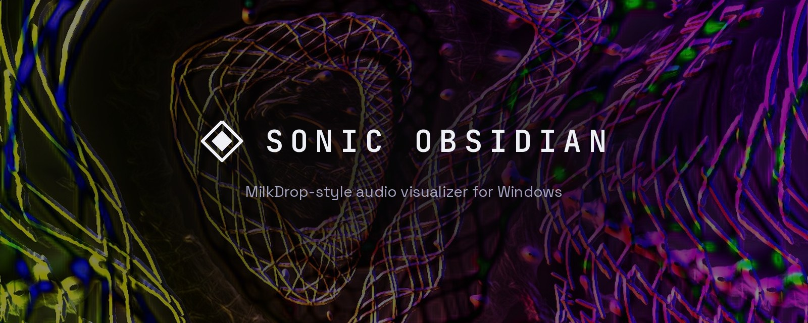
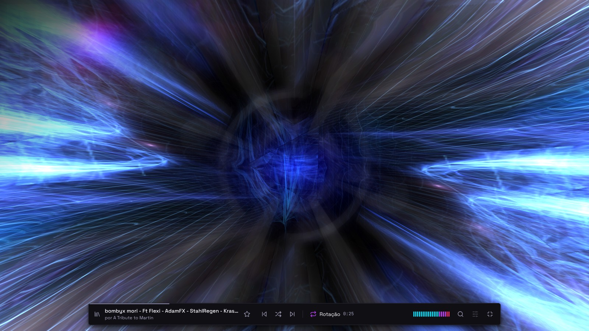
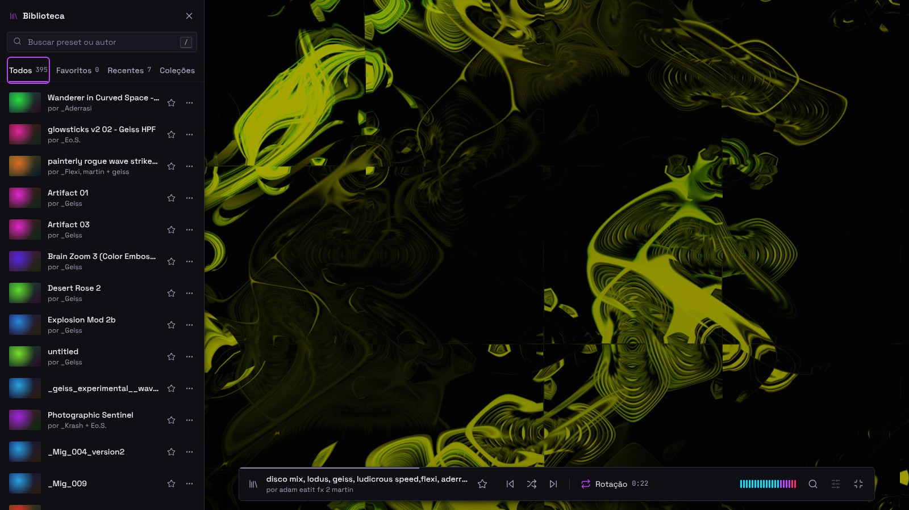
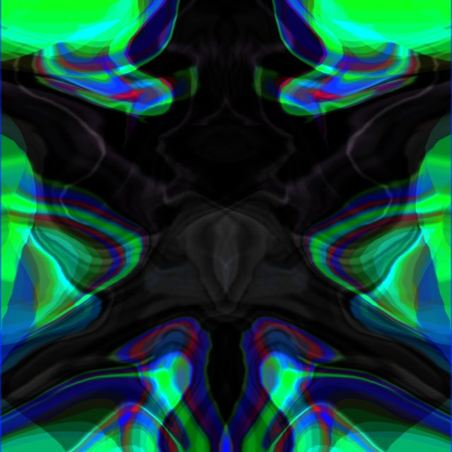
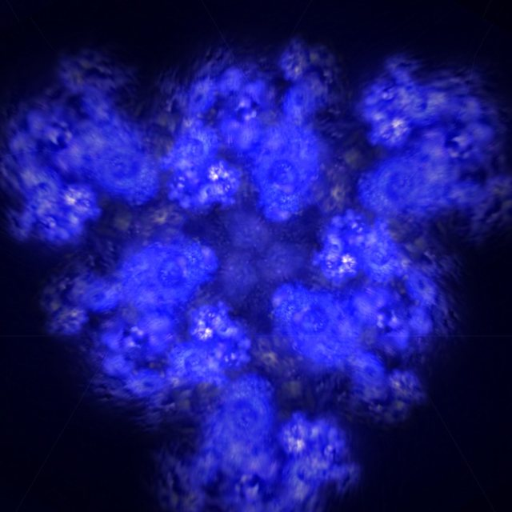
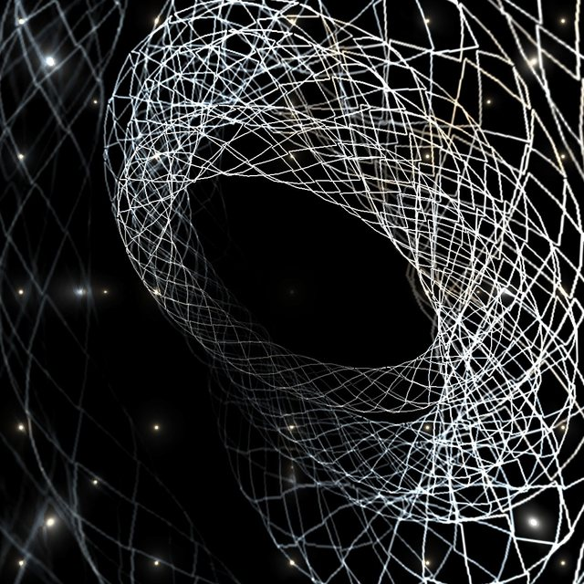
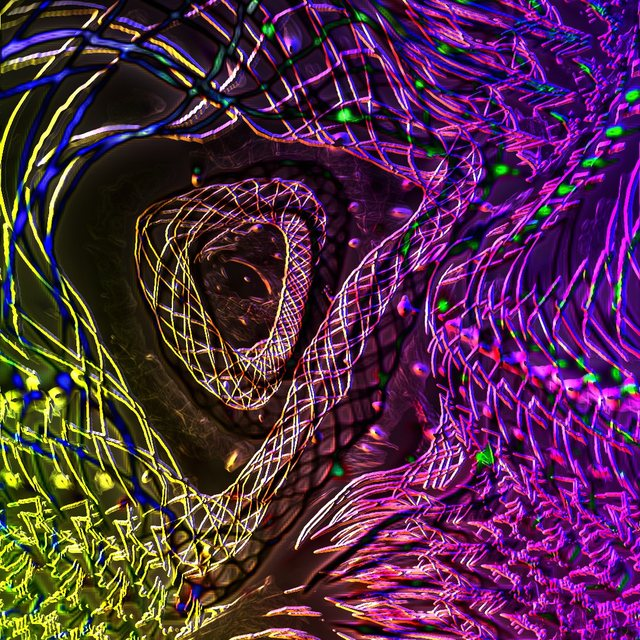
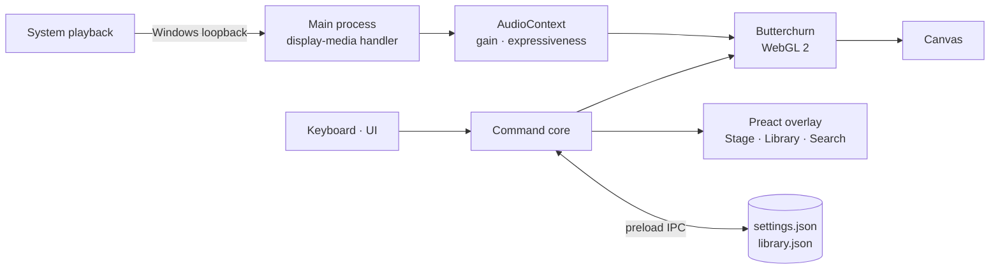
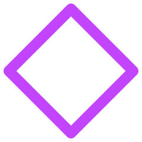

<p align="center">
  <picture>
    <source media="(prefers-color-scheme: dark)" srcset="docs/brand/lockup-dark.png">
    <source media="(prefers-color-scheme: light)" srcset="docs/brand/lockup-light.png">
    
  </picture>
</p>

<p align="center">
  <b>A MilkDrop-style audio visualizer for Windows.</b><br>
  If you play it, it lights up.
</p>

<p align="center">
  
  
  
  
  
  
</p>

<p align="center">
  <a href="#what-it-is">What it is</a> ·
  <a href="#features">Features</a> ·
  <a href="#keyboard">Keyboard</a> ·
  <a href="#privacy">Privacy</a> ·
  <a href="#development">Development</a> ·
  <a href="#roadmap">Roadmap</a> ·
  <a href="#credits">Credits</a> ·
  <a href="README.pt-BR.md">Português</a>
</p>

<p align="center">
  
</p>

## What it is

Sonic Obsidian is a desktop app that turns the audio you choose to play — Spotify, YouTube, a game, a DAW — into live, music-reactive visuals. It brings back the experience of Winamp's MilkDrop: open it, play something, and the screen comes alive. No setup, no virtual cable, no microphone.

Under the hood it runs [Butterchurn](https://github.com/jberg/butterchurn), a WebGL 2 implementation of MilkDrop 2, with its library of community presets. On top of that sits the Sonic Obsidian interface: a quiet, exact shell around something alive.

> [!NOTE]
> **Status:** in active development. Phase 2 (the full interface) is under way. The code is MIT-licensed; the repository stays private until the first public release.

<p align="center">
  
  <br><sub>The Stage: the visual takes the whole window and the control strip appears only when you need it.</sub>
</p>

<p align="center">
  
  <br><sub>The Library: search by preset or author, favorites, recents and collections, without leaving the visual.</sub>
</p>

### Presets

395 presets from the MilkDrop community ship with the app. A few of them, captured from Butterchurn:

<table>
  <tr>
    <td></td>
    <td></td>
    <td></td>
  </tr>
  <tr>
    <td><sub>Aderrasi — Potion of Spirits</sub></td>
    <td><sub>Martin — liquid arrows</sub></td>
    <td><sub>ORB — Waaa</sub></td>
  </tr>
  <tr>
    <td></td>
    <td></td>
    <td></td>
  </tr>
  <tr>
    <td><sub>Rovastar + Loadus + Geiss — FractalDrop (Triple Mix)</sub></td>
    <td><sub>Geiss + Flexi + Martin — disconnected</sub></td>
    <td><sub>Geiss, Flexi + Stahlregen — Thumbdrum Tokamak</sub></td>
  </tr>
</table>

Every preset is someone's work. The preset name carries its authors, and the app never removes or renames it.

## Features

**Working today**

- **Zero-setup capture.** The app picks up system playback through Windows loopback and starts reacting in about two seconds, with no picker and no click.
- **The Stage.** Frameless window or clean fullscreen. The control strip hides on its own; the cursor disappears in fullscreen.
- **Preset signature.** On every change, the preset name and its authors appear briefly over the visual. Clean mode (`T`) turns overlay text off.
- **Quick search and Library.** `/` or `Ctrl+K` finds any preset by name or author. The Library drawer (`L`) has tabs, favorites and recents.
- **Transitions you choose.** Pick the transition type and duration, for manual changes and for auto-rotation separately. `Shift` on any change makes a hard cut.
- **Auto-rotation** with an adjustable interval.
- **Expressiveness.** `+` / `−` set how strongly the visual reacts; `X` cycles its character and `Shift+X` its memory. Input gain adapts on its own.
- **Silence state.** When nothing is playing, the app says so instead of showing a frozen frame.
- **Persistence.** Settings and library survive restarts.
- **Diagnostics.** `Ctrl+Shift+D` shows a debug HUD (fps, memory, audio); a log file records crashes and GPU events.

**Coming next** — the full Settings screen, first-run setup and diagnostics, performance per preset, audio files and microphone as sources, importing and creating `.milk` presets in a Studio, and a local [MCP](https://modelcontextprotocol.io) server so the AI tool you already use can control the app live and author presets. The app itself never embeds AI. Full plan in [Roadmap](#roadmap).

## Keyboard

| Key | Action |
|---|---|
| `→` / `←` | Next / previous preset |
| `Space` | Random preset |
| `Shift` + any of the above | Hard cut (no transition) |
| `B` / `Shift+B` | Cycle the transition type |
| `↑` / `↓` | Transition duration (0.25 s to 8 s) |
| `R` | Auto-rotation on/off |
| `,` | Quick settings (gain, rotation, transitions, expressiveness, text over the visual) |
| `+` / `−` / `0` | Expressiveness up / down / reset |
| `X` / `Shift+X` | Character / memory of the reaction |
| `/` or `Ctrl+K` | Quick search |
| `L` | Library |
| `F` | Fullscreen |
| `T` | Clean mode (no text over the visual) |
| `H` | Hide the interface now |
| `Esc` | Close what is open, or leave fullscreen |
| `Ctrl+Shift+D` | Debug HUD |
| `Ctrl+Shift+L` | Open the log folder |

## Privacy

- **Audio is analyzed in memory and never saved or uploaded.** The app has no account, no telemetry and no network calls of its own.
- It visualizes what your system is playing. Content protected by DRM is out of scope, and the app does not try to work around it.
- Integration with AI tools will be opt-in, local only (`127.0.0.1`), off by default, with a token and scoped permissions.

## Requirements

- Windows 10 or 11
- A GPU with WebGL 2 support
- Any audio output device (speakers, headphones, virtual devices such as Voicemeeter)

## Development

The app is built with Electron, electron-vite and TypeScript. The interface overlay uses Preact.

```bash
npm ci            # install dependencies
npm run typecheck # type-check main and renderer
npm run build     # compile to out/
npm run dist:win  # build + portable Windows folder in release/win-unpacked/
npm run dev       # run with hot reload (needs a desktop session)
```

System audio capture uses Chromium's loopback, which only exists on Windows, so the app has to run on Windows to be tested for real. Every push runs [`build-windows.yml`](.github/workflows/build-windows.yml), which type-checks on Ubuntu and builds a portable app on `windows-latest`, published as the `sonic-obsidian-win-<sha>` artifact.

### How it works



Keyboard, interface and, later, MCP are all clients of one **command core** (`preset.next`, `rotation.set`, `library.favorite`…). Nothing talks to the engine directly. Details in [docs/architecture.md](docs/architecture.md).

### Repository layout

```
src/
  main/        Electron main process: window, loopback handler, storage, log
  preload/     narrow API exposed to the page as window.so
  renderer/    Butterchurn, audio graph, command core and the Preact overlay
docs/
  PRD.md       product and roadmap (anchor document)
  architecture.md
  specs/       one spec per feature (001–015 so far)
  design/      interface: v3 prototype mirror, explorations, moodboard
  brand/       logo files
  research/    technical research (MilkDrop, FFT, effects)
legacy/python/ the first version (Python + Pygame), kept for reference
```

The documentation index is in [docs/README.md](docs/README.md) (in Portuguese).

### How the project is built

Each feature starts as a spec in [`docs/specs/`](docs/specs/), becomes an entry in [TASKS.md](TASKS.md) and a GitHub issue, and lands through a pull request. Decisions and what was discarded live in [DECISIONS.md](DECISIONS.md); a log of every working session in [SESSIONS.md](SESSIONS.md). Code is written with [Claude Code](https://claude.com/claude-code), and the interface is designed in Claude Design and mirrored in [`docs/design/v3/`](docs/design/v3/README.md). The structure follows [workspace//kit](https://github.com/atempel/workspace-kit).

## Roadmap

| Phase | Goal | State |
|---|---|---|
| 0 — Spike | Prove loopback + Butterchurn in Electron | Done |
| 1 — Core | Presets by keyboard, rotation, window, input signal | Done |
| 2 — Interface v3 | Stage, Library, search, transitions, settings, setup | In progress |
| 3 — Sources and presets | Microphone, audio files, `.milk` import, preset Studio | Planned |
| 4 — MCP | Live control and preset authoring from your AI tool | Planned |
| 5 — Extras | Multi-monitor rack, beat/BPM, installer, start with Windows | Planned |

Details in [docs/PRD.md](docs/PRD.md); current work in [TASKS.md](TASKS.md).

## Credits

Sonic Obsidian exists because other people did the hard part and opened their code:

- **[Butterchurn](https://github.com/jberg/butterchurn)**, by Jordan Berg and contributors (MIT): the whole visual engine. A WebGL implementation of MilkDrop 2, used as a dependency with no fork and no changes.
- **[MilkDrop](https://www.geisswerks.com/milkdrop/)**, by Ryan Geiss (Nullsoft): the original visualizer that inspires all of this, and **Winamp**, where many of us first saw it.
- **Presets** from [butterchurn-presets](https://github.com/jberg/butterchurn-presets): works by artists of the MilkDrop community. Each preset's name carries its authors' credit.

Thank you. License texts for these dependencies are in [THIRD_PARTY_NOTICES.md](THIRD_PARTY_NOTICES.md), which also ships inside the app folder.

## License

[MIT](LICENSE) © 2026 Alexandre Tempel. Butterchurn and the presets keep their own licenses and credits — see [THIRD_PARTY_NOTICES.md](THIRD_PARTY_NOTICES.md).

Want to help? Read [CONTRIBUTING.md](CONTRIBUTING.md). Found a security issue? See [SECURITY.md](SECURITY.md).

<p align="center">
  <br>
  <sub>Made with ♥ in São Paulo by <a href="https://github.com/atempel">Alexandre Tempel</a></sub>
</p>
