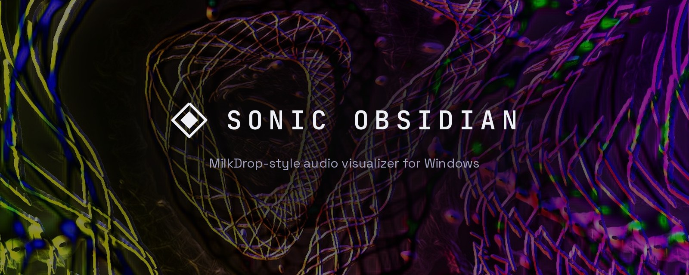
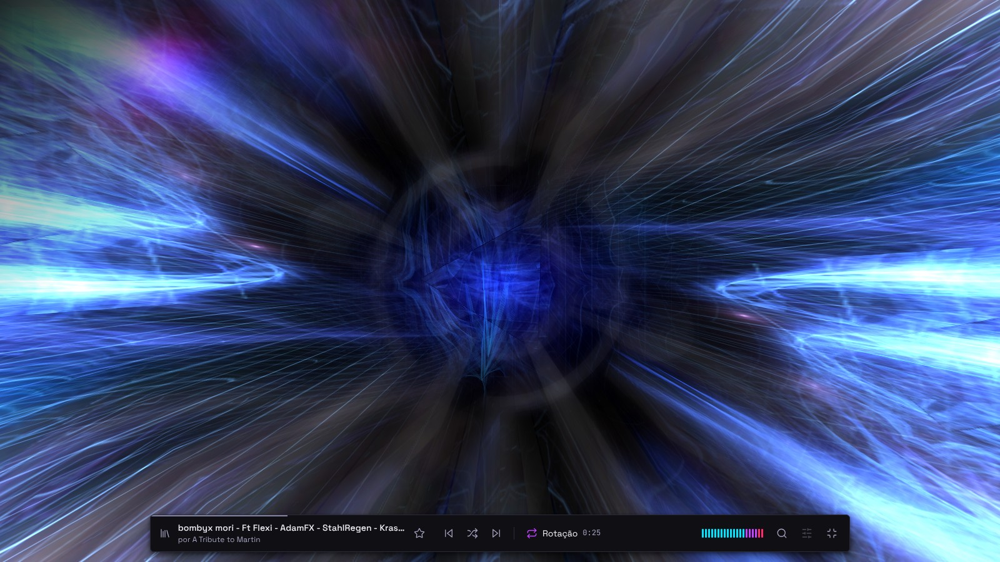
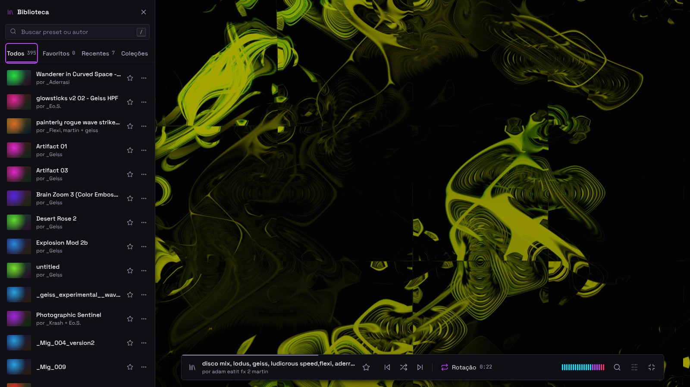
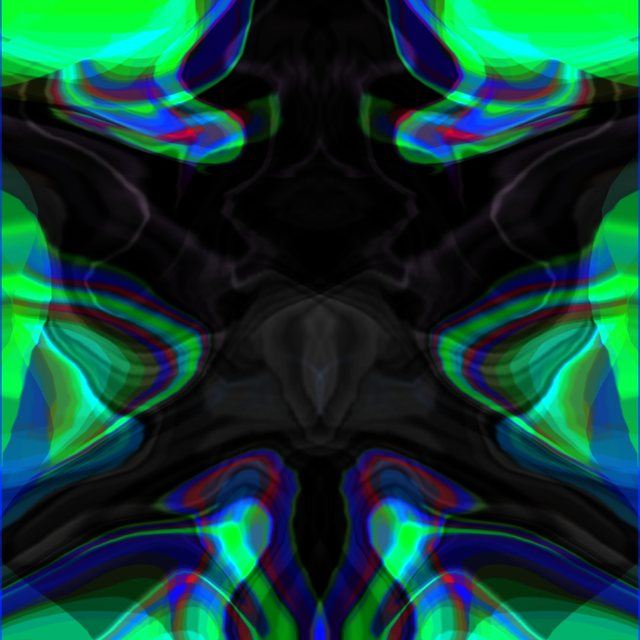
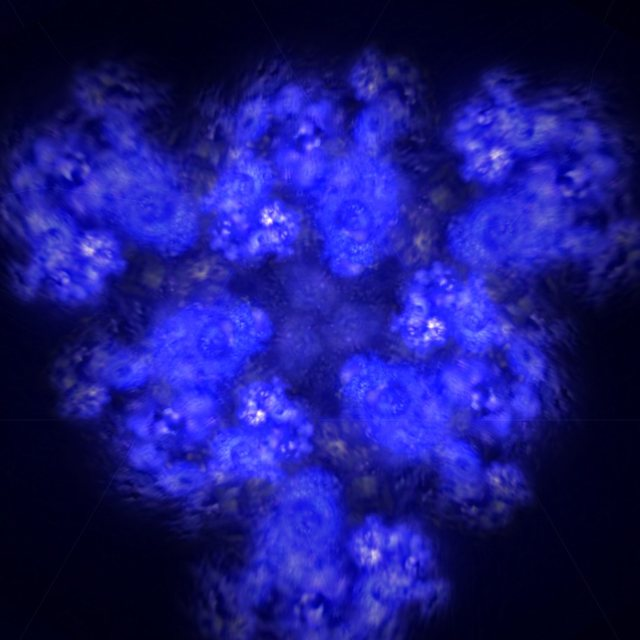
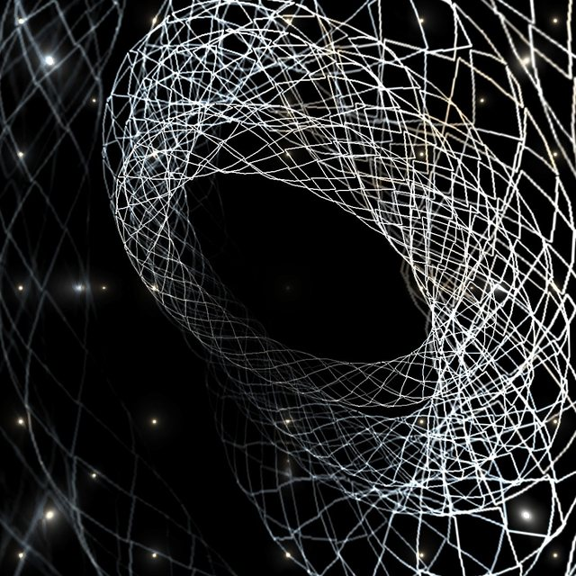
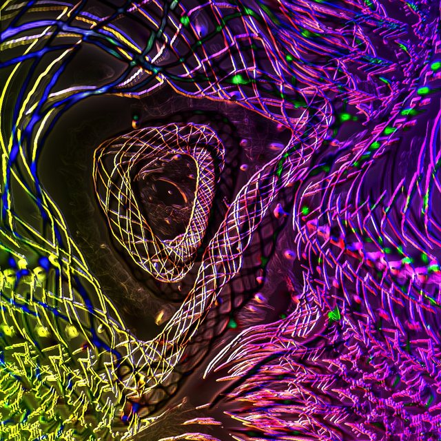
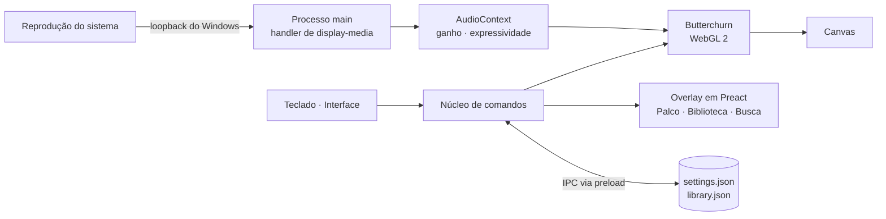
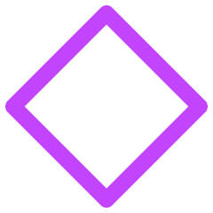

<p align="center">
  <picture>
    <source media="(prefers-color-scheme: dark)" srcset="docs/brand/lockup-dark.png">
    <source media="(prefers-color-scheme: light)" srcset="docs/brand/lockup-light.png">
    
  </picture>
</p>

<p align="center">
  <b>Um visualizador de áudio estilo MilkDrop para Windows.</b><br>
  Se você toca, ele acende.
</p>

<p align="center">
  
  
  
  
  
</p>

<p align="center">
  <a href="#o-que-é">O que é</a> ·
  <a href="#recursos">Recursos</a> ·
  <a href="#teclado">Teclado</a> ·
  <a href="#privacidade">Privacidade</a> ·
  <a href="#desenvolvimento">Desenvolvimento</a> ·
  <a href="#roadmap">Roadmap</a> ·
  <a href="#créditos">Créditos</a> ·
  <a href="README.md">English</a>
</p>

<p align="center">
  
</p>

## O que é

O Sonic Obsidian é um app de desktop que transforma o áudio que você escolhe tocar — Spotify, YouTube, um jogo, uma DAW — em imagens ao vivo, reativas à música. Ele traz de volta a experiência do MilkDrop, do Winamp: abra, toque algo e a tela ganha vida. Sem configuração, sem cabo virtual, sem microfone.

Por baixo, roda o [Butterchurn](https://github.com/jberg/butterchurn), uma implementação em WebGL 2 do MilkDrop 2, com sua biblioteca de presets da comunidade. Por cima fica a interface do Sonic Obsidian: uma casca quieta e exata em volta de algo vivo.

> [!NOTE]
> **Status:** em desenvolvimento ativo e privado por enquanto. A fase 2 (a interface completa) está em andamento. A ideia é abrir o código sob a licença MIT quando o projeto estiver pronto. Até lá o código é proprietário — veja [Licença](#licença).

<p align="center">
  
  <br><sub>O Palco: o visual ocupa a janela inteira e a faixa de controle só aparece quando você precisa.</sub>
</p>

<p align="center">
  
  <br><sub>A Biblioteca: busca por preset ou autor, favoritos, recentes e coleções, sem sair do visual.</sub>
</p>

### Presets

O app já vem com 395 presets da comunidade MilkDrop. Alguns deles, capturados do Butterchurn:

<table>
  <tr>
    <td></td>
    <td></td>
    <td></td>
  </tr>
  <tr>
    <td><sub>Aderrasi — Potion of Spirits</sub></td>
    <td><sub>Martin — liquid arrows</sub></td>
    <td><sub>ORB — Waaa</sub></td>
  </tr>
  <tr>
    <td></td>
    <td></td>
    <td></td>
  </tr>
  <tr>
    <td><sub>Rovastar + Loadus + Geiss — FractalDrop (Triple Mix)</sub></td>
    <td><sub>Geiss + Flexi + Martin — disconnected</sub></td>
    <td><sub>Geiss, Flexi + Stahlregen — Thumbdrum Tokamak</sub></td>
  </tr>
</table>

Todo preset é obra de alguém. O nome do preset leva o crédito dos autores, e o app nunca o remove nem o renomeia.

## Recursos

**Funcionando hoje**

- **Captura sem configuração.** O app capta a reprodução do sistema pelo loopback do Windows e começa a reagir em cerca de dois segundos, sem seletor e sem clique.
- **O Palco.** Janela sem moldura ou tela cheia limpa. A faixa de controle se esconde sozinha; em tela cheia, o cursor some.
- **Assinatura do preset.** A cada troca, o nome do preset e seus autores aparecem por um instante sobre o visual. O Modo limpo (`T`) desliga o texto sobreposto.
- **Busca rápida e Biblioteca.** `/` ou `Ctrl+K` encontra qualquer preset por nome ou autor. A gaveta da Biblioteca (`L`) tem abas, favoritos e recentes.
- **Transições à sua escolha.** Escolha o tipo e a duração da transição, separadamente para trocas manuais e para a rotação automática. `Shift` em qualquer troca faz um corte seco.
- **Rotação automática** com intervalo ajustável.
- **Expressividade.** `+` / `−` definem a intensidade da reação do visual; `X` alterna o Caráter e `Shift+X` a Memória. O ganho de entrada se adapta sozinho.
- **Estado de silêncio.** Quando nada está tocando, o app avisa em vez de mostrar um quadro congelado.
- **Persistência.** Configurações e biblioteca sobrevivem ao reinício.
- **Diagnóstico.** `Ctrl+Shift+D` mostra um HUD de depuração (fps, memória, áudio); um arquivo de log registra travamentos e eventos da GPU.

**Próximos passos** — Ajustes rápidos e a tela de Configurações completa, configuração do primeiro uso e diagnóstico, desempenho por preset, arquivos de áudio e microfone como fontes, importação e criação de presets `.milk` em um Estúdio, e um servidor [MCP](https://modelcontextprotocol.io) local para que a ferramenta de IA que você já usa possa controlar o app ao vivo e criar presets. O app em si nunca embute IA. Plano completo no [Roadmap](#roadmap).

## Teclado

| Tecla | Ação |
|---|---|
| `→` / `←` | Próximo / anterior preset |
| `Espaço` | Preset aleatório |
| `Shift` + qualquer uma das anteriores | Corte seco (sem transição) |
| `B` / `Shift+B` | Alterna o tipo de transição |
| `↑` / `↓` | Duração da transição (0,25 s a 8 s) |
| `R` | Liga/desliga a rotação automática |
| `[` / `]` | Intervalo da rotação |
| `+` / `−` / `0` | Aumenta / diminui / restaura a Expressividade |
| `X` / `Shift+X` | Caráter / Memória da reação |
| `/` ou `Ctrl+K` | Busca rápida |
| `L` | Biblioteca |
| `F` | Tela cheia |
| `T` | Modo limpo (sem texto sobre o visual) |
| `H` | Esconde a interface agora |
| `Esc` | Fecha o que estiver aberto, ou sai da tela cheia |
| `Ctrl+Shift+D` | HUD de depuração |
| `Ctrl+Shift+L` | Abre a pasta de logs |

## Privacidade

- **O áudio é analisado em memória e nunca é salvo nem enviado.** O app não tem conta, não tem telemetria e não faz chamadas de rede próprias.
- Ele visualiza o áudio que você escolhe tocar. Conteúdo protegido por DRM está fora do escopo, e o app não tenta contornar a proteção.
- A integração com ferramentas de IA será opcional, apenas local (`127.0.0.1`), desligada por padrão, com token e permissões restritas.

## Requisitos

- Windows 10 ou 11
- Uma GPU com suporte a WebGL 2
- Qualquer dispositivo de saída de áudio (caixas de som, fones, dispositivos virtuais como o Voicemeeter)

## Desenvolvimento

O app é feito com Electron, electron-vite e TypeScript. A camada de interface usa Preact.

```bash
npm ci            # instala as dependências
npm run typecheck # checa os tipos de main e renderer
npm run build     # compila para out/
npm run dist:win  # build + pasta portátil do Windows em release/win-unpacked/
npm run dev       # roda com hot reload (precisa de uma sessão de desktop)
```

A captura de áudio do sistema usa o loopback do Chromium, que só existe no Windows. Por isso o app precisa rodar no Windows para ser testado de verdade. Cada push executa o [`build-windows.yml`](.github/workflows/build-windows.yml), que checa os tipos no Ubuntu e gera um app portátil no `windows-latest`, publicado como o artifact `sonic-obsidian-win-<sha>`.

### Como funciona



Teclado, interface e, mais adiante, o MCP são todos clientes de um único **núcleo de comandos** (`preset.next`, `rotation.set`, `library.favorite`…). Nada fala direto com o motor. Detalhes em [docs/architecture.md](docs/architecture.md).

### Estrutura do repositório

```
src/
  main/        processo main do Electron: janela, handler de loopback, armazenamento, log
  preload/     API estreita exposta à página como window.so
  renderer/    Butterchurn, grafo de áudio, núcleo de comandos e o overlay em Preact
docs/
  PRD.md       produto e roadmap (documento âncora)
  architecture.md
  specs/       uma spec por feature (001–015 até agora)
  design/      interface: espelho do protótipo v3, explorações, moodboard
  brand/       arquivos do logo
  research/    pesquisa técnica (MilkDrop, FFT, efeitos)
legacy/python/ a primeira versão (Python + Pygame), mantida como referência
```

O índice da documentação está em [docs/README.md](docs/README.md).

### Como o projeto é feito

Cada feature começa como uma spec em [`docs/specs/`](docs/specs/), vira uma entrada no [TASKS.md](TASKS.md) e uma issue no GitHub, e chega por pull request. As decisões e o que foi descartado ficam no [DECISIONS.md](DECISIONS.md); o registro de cada sessão de trabalho fica no [SESSIONS.md](SESSIONS.md). O código é escrito com o [Claude Code](https://claude.com/claude-code), e a interface é desenhada no Claude Design e espelhada em [`docs/design/v3/`](docs/design/v3/README.md). A estrutura segue o [workspace//kit](https://github.com/atempel/workspace-kit).

## Roadmap

| Fase | Objetivo | Estado |
|---|---|---|
| 0 — Spike | Provar loopback + Butterchurn no Electron | Concluída |
| 1 — Núcleo | Presets pelo teclado, rotação, janela, sinal de entrada | Concluída |
| 2 — Interface v3 | Palco, Biblioteca, busca, transições, configurações, setup | Em andamento |
| 3 — Fontes e presets | Microfone, arquivos de áudio, importação de `.milk`, Estúdio de presets | Planejada |
| 4 — MCP | Controle ao vivo e criação de presets pela sua ferramenta de IA | Planejada |
| 5 — Extras | Rack multi-monitor, beat/BPM, instalador, iniciar com o Windows | Planejada |

Detalhes no [docs/PRD.md](docs/PRD.md); o trabalho atual está no [TASKS.md](TASKS.md).

## Créditos

O Sonic Obsidian existe porque outras pessoas fizeram a parte difícil e abriram seu código:

- **[Butterchurn](https://github.com/jberg/butterchurn)**, de Jordan Berg e colaboradores (MIT): todo o motor visual. Uma implementação em WebGL do MilkDrop 2, usada como dependência, sem fork e sem alterações.
- **[MilkDrop](https://www.geisswerks.com/milkdrop/)**, de Ryan Geiss (Nullsoft): o visualizador original que inspira tudo isto, e o **Winamp**, onde muitos de nós o vimos pela primeira vez.
- **Presets** do [butterchurn-presets](https://github.com/jberg/butterchurn-presets): obras de artistas da comunidade MilkDrop. O nome de cada preset leva o crédito de seus autores.

Obrigado. Os textos de licença dessas dependências estão em [THIRD_PARTY_NOTICES.md](THIRD_PARTY_NOTICES.md), que também acompanha a pasta do app.

## Licença

Proprietária por enquanto — veja [LICENSE](LICENSE). A ideia é que o projeto se torne código aberto sob a licença MIT quando estiver pronto para o lançamento público.

<p align="center">
  <br>
  <sub>Feito com ♥ em São Paulo por <a href="https://github.com/atempel">Alexandre Tempel</a></sub>
</p>
