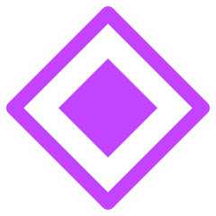
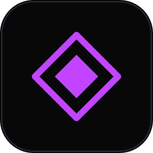
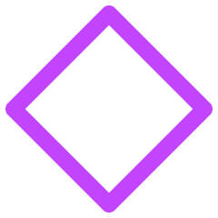

# Marca — The Core

A marca do Sonic Obsidian é um losango dentro de um losango. A **casca** (contorno fino) é a obsidiana: o app, quieto e preciso. O **núcleo** (sólido) é o som: a única parte que pode reagir.

A fonte da verdade é o Design System "Sonic Obsidian" no Claude Design ([artefato](https://claude.ai/artifact/PsbByhFqsyarVehitA8rPZ), página *The Core*). Esta pasta guarda os arquivos prontos para uso no repo, no README e na landing page.

  &nbsp;&nbsp;
  &nbsp;&nbsp;
  

## Arquivos
| Arquivo | Uso |
|---|---|
| `mark.svg` | Marca em violeta (`#C244FF`). Padrão em qualquer tela escura. |
| `mark-white.svg` | Branco (`#EEEEF5`), sobre o visual ou sobre foto. |
| `mark-ink.svg` | Tinta (`#080809`), para fundos claros e impressão. |
| `shell.svg` | Só a casca, sem núcleo: assinatura discreta em rodapés e créditos. Nunca animada. |
| `app-icon.svg` | Ícone do app: a marca a 62% de um bloco `bg-00` com borda interna `line-2`. |
| `lockup-dark.png` | Marca + wordmark para fundo escuro (wordmark em `text-1`). |
| `lockup-light.png` | Marca + wordmark para fundo claro (wordmark em tinta). |
| `lockup-white.png` | Tudo em branco, sobre o visual ou sobre foto. |

## Construção (grade de 24)
- **Casca:** vértices em 1,5 / 22,5, traço 1,6, cantos arredondados, sem preenchimento.
- **Núcleo:** vértices em 6,5 / 17,5, sólido.
- **Respiro:** uma largura de núcleo (11 unidades a 24) em volta. **Mínimo:** 12 px.
- **Lockup horizontal:** marca a 1,7× a altura das maiúsculas, espaço de uma largura de núcleo, wordmark `SONIC OBSIDIAN` em JetBrains Mono 600, tracking 0,22em.

## Não fazer
Girar até virar quadrado; preencher a casca ou contornar o núcleo; animar a casca; gradientes, chanfros ou brilho na marca estática; cores fora de violeta, beat, warn, branco e tinta; usar o glifo ◆ no lugar da marca.

Os PNGs foram gerados a partir da construção acima. Se o Design System mudar a marca, regenere-os e atualize esta página.

## Ícone do app no Windows
`resources/icon.ico` (16, 20, 24, 32, 40, 48, 64, 128 e 256 px, com transparência) e `resources/icon.png` (256 px) são gerados de `app-icon.svg`: render no Chromium (Playwright) em cada tamanho e `convert` (ImageMagick) para juntar o `.ico`. O main usa o `.ico` como ícone da janela e da barra de tarefas; o `electron-builder.yml` o aponta em `win.icon`. Se a marca mudar, regenere os dois.
