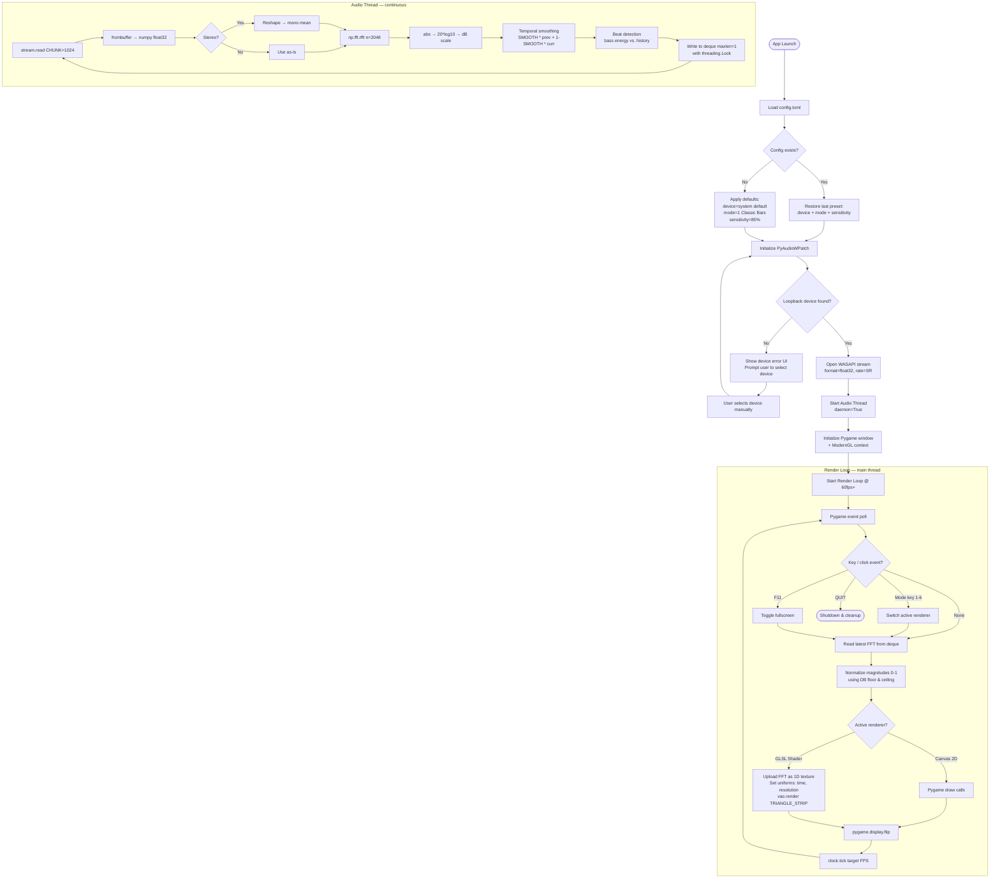
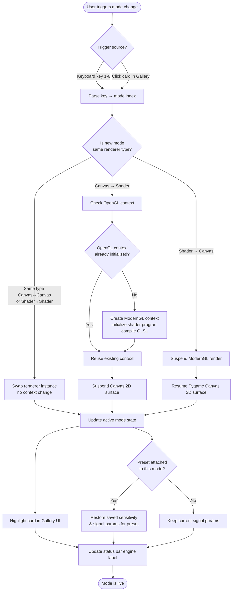

# Sonic Obsidian — Product Requirements Document

> **Version:** 1.0
> **Last Updated:** March 2026
> **Status:** Active Development — Phase 1 complete, Phase 2 in progress
> **For:** AI agents, developers, and collaborators working on this project

---

## Table of Contents

1. [Product Overview](#1-product-overview)
2. [Vision & Goals](#2-vision--goals)
3. [Personas](#3-personas)
4. [Feature Requirements by Phase](#4-feature-requirements-by-phase)
5. [UI/UX Specifications](#5-uiux-specifications)
6. [Visual Modes Catalog](#6-visual-modes-catalog)
7. [System Flowcharts](#7-system-flowcharts)
8. [Technical Architecture](#8-technical-architecture)
9. [Signal Processing Pipeline](#9-signal-processing-pipeline)
10. [Known Limitations & Constraints](#10-known-limitations--constraints)
11. [Roadmap Summary](#11-roadmap-summary)

---

## 1. Product Overview

**Sonic Obsidian** is a high-performance, real-time audio visualizer for Windows. It captures audio output from the system via WASAPI loopback and renders reactive visual effects synchronized to the audio signal — frequency spectrum, beat, and amplitude.

The product is inspired by classic Winamp visualizers (MilkDrop, AVS) and aims to bring that same aesthetic quality and real-time expressiveness to a modern, standalone Python desktop application.

**Platform:** Windows (WASAPI loopback is Windows-native)
**Current Version:** V2.4.0 High-Performance
**Runtime Target:** 60–144 FPS with < 5ms audio latency
**Distribution:** Personal use — no code signing or public distribution required

---

## 2. Vision & Goals

### Vision Statement

Sonic Obsidian transforms any audio playing on the user's computer into a living, reactive visual experience — from classic frequency bars to GPU-driven psychedelic shaders — with zero audio interruption and minimal configuration friction.

### Product Goals

| Priority | Goal |
|---|---|
| P0 | Capture system audio in real-time via WASAPI loopback without interrupting playback |
| P0 | Render reactive visuals at stable 60fps minimum |
| P1 | Allow real-time switching between multiple visual modes |
| P1 | Expose audio sensitivity and signal controls via the UI |
| P1 | Support multiple audio output devices (DAC, headphones, HDMI) |
| P2 | Provide a preset system for saving and loading visual configurations |
| P2 | Support GPU-accelerated GLSL shaders for advanced effects |
| P3 | Package as a standalone `.exe` with no Python dependency |

### Non-Goals (explicitly out of scope)

- Recording or exporting audio or video output
- DRM-protected audio content capture
- macOS / Linux support
- Cloud sync or remote control
- Multi-monitor span

---

## 3. Personas

Personas are defined based on the primary use contexts for Sonic Obsidian. Even though it's a personal-use application, defining personas helps clarify what the system needs to do in each context and drives feature prioritization.

---

### Persona 1 — The Power Listener

**Name:** Alexandre
**Role:** Developer and primary user of Sonic Obsidian
**Context:** Home listening session — music playing from Spotify, YouTube, or local files through a high-fidelity audio setup (FiiO K5 Pro DAC + studio monitors)

**Goals:**
- High visual quality that feels proportional to the audio being played
- Ability to quickly switch visual modes depending on mood or music genre
- Technical stats visible at a glance (FPS, latency, sample rate)
- Full control over sensitivity, smoothing, and signal thresholds
- Fast startup — the app should be rendering within seconds of launch

**Frustrations:**
- Visual stutter or lag that breaks immersion
- Having to reconfigure settings every session
- Janky UIs that feel like a prototype

**How Sonic Obsidian serves this persona:**
The app should boot directly into the last active preset, show FPS/latency in the status bar, and allow signal adjustments via sliders without leaving the active visual. Mode switching via keyboard (keys 1–6) must be instantaneous.

---

### Persona 2 — The Ambient Host

**Name:** Alexandre (social context)
**Role:** Hosting guests at home — music is playing as ambient background, the visualizer is running on a secondary screen or TV
**Context:** The app runs unattended for extended periods; guests see the visuals as part of the atmosphere

**Goals:**
- Visually impressive modes that work without tuning (Trail/Decay, Psychedelic Warp)
- No UI chrome visible — fullscreen mode with clean visuals only
- Stable operation over hours without crashes or intervention
- Beat-synchronized effects that respond to whatever music is playing

**Frustrations:**
- Having to touch the app during a social event
- Modes that look flat or boring when set-it-and-forget-it
- Crashes or hangs that kill the vibe

**How Sonic Obsidian serves this persona:**
Fullscreen mode (F11) must hide all UI. The Psychedelic Warp and Trail/Decay modes should look compelling with zero tuning. Beat detection should work reliably across genres. The engine status bar should not be visible in fullscreen.

---

### Persona 3 — The Visual Engineer

**Name:** Alexandre (development context)
**Role:** Actively developing and testing the engine — writing GLSL shaders, tuning the FFT pipeline, or adding a new visual mode
**Context:** Working session in code editor + Sonic Obsidian side-by-side; iterating on shaders or signal parameters

**Goals:**
- Live reload of shader `.frag` files without restarting the app
- Access to raw signal data (FFT values, beat state, BPM) for debugging
- Ability to switch between Canvas 2D and ModernGL renderers easily
- Granular controls: DB floor, DB ceiling, FFT size, smoothing factor
- Clear separation in the codebase between capture, analysis, and render layers

**Frustrations:**
- Long feedback loops when iterating on shaders
- Magic numbers buried in code with no UI knob
- Audio thread crashes that take down the entire application

**How Sonic Obsidian serves this persona:**
The Sensitivity page (System Configuration) must expose all signal parameters as live sliders. Stats page must show raw FFT metrics. The renderer architecture must make it easy to add a new visual mode without touching unrelated code.

---

## 4. Feature Requirements by Phase

### Phase 1 — Foundation ✅ (Complete)

**Objective:** A fully functional visualizer in a single `.py` file.

| Feature | Description | Priority |
|---|---|---|
| WASAPI loopback capture | Capture the default audio output device via PyAudioWPatch | P0 |
| FFT analysis | `np.fft.rfft()` with temporal smoothing (SMOOTH = 0.85) | P0 |
| Beat detection | Bass energy vs. rolling historical average, threshold 1.5x | P0 |
| Classic Bars (Mode 1) | Vertical FFT magnitude bars with gravity decay | P0 |
| Oscilloscope (Mode 2) | Time-domain waveform rendering | P0 |
| Circular Radial (Mode 3) | Polar frequency bars, 360-degree iris | P0 |
| Trail/Decay (Mode 4) | Persistence-of-vision via alpha fade overlay | P0 |
| Keyboard mode switching | Keys 1–4 switch modes instantly | P0 |
| Threading | Audio thread + render thread isolated via `deque(maxlen=1)` + Lock | P0 |

---

### Phase 2 — Usability (Current Phase)

**Objective:** GUI controls, device selection, and multi-mode support in a polished interface.

| Feature | Description | Priority |
|---|---|---|
| Visual Modes Gallery | Grid UI to browse and activate modes with previews | P0 |
| Device Selector | List all WASAPI output devices, pick the active loopback | P0 |
| Beat Engine toggle | Enable/disable beat detection; show live BPM | P0 |
| Sensitivity controls | Sliders for Sensitivity, Smoothing, DB Floor, DB Ceiling | P0 |
| Reaction Threshold slider | Global reaction threshold control | P1 |
| FFT Smoothing slider | Independent FFT smoothing adjustment | P1 |
| Fullscreen mode | F11 toggles fullscreen, hides all UI chrome | P1 |
| Engine status bar | Always-visible: FPS, sample rate, buffer size, latency | P1 |
| Keys 1–6 mode switching | Extended to cover all 6 visual modes | P1 |
| Preset: New Preset button | Creates a named preset from current configuration | P2 |

---

### Phase 3 — Advanced Effects

**Objective:** GPU-accelerated rendering via ModernGL + GLSL shaders.

| Feature | Description | Priority |
|---|---|---|
| Shader Bars (Mode 5) | Custom GLSL fragment shader — frequency bars on GPU | P0 |
| Psychedelic Warp (Mode 6) | Raymarching SDF engine — infinite geometric warping + light refraction | P0 |
| Audio as 1D texture | FFT data passed to shaders as `sampler1D` texture uniform | P0 |
| Time uniform | `float time` passed to all shaders for animated effects | P0 |
| Resolution uniform | `vec2 resolution` for aspect-correct UV coordinates | P0 |
| Live shader reload | Watch `.frag` files for changes and hot-reload without restart | P1 |
| Perlin noise integration | Noise-based warp fields in psychedelic shader | P1 |
| Motion blur / bloom | Post-process passes layered on top of primary render | P2 |
| Preset `.frag` files | Interchaneable GLSL presets saved as `.frag` files | P2 |
| Smooth preset transitions | Cross-fade between two shader presets | P3 |

---

### Phase 4 — Packaging (Optional)

| Feature | Description | Priority |
|---|---|---|
| PyInstaller bundle | Single `.exe` with no external Python dependency | P1 |
| `config.toml` persistence | Save last-used preset, device, and sensitivity settings | P0 |
| App icon | Custom icon in taskbar and `.exe` | P2 |

---

## 5. UI/UX Specifications

Sonic Obsidian's UI follows a dark, high-contrast design system. The interface is divided into a persistent left navigation sidebar and a main content area. A fixed status bar sits at the bottom of every screen.

### Design Principles

- **Dark-first:** Background is near-black (`#0A0A14` range). High contrast text and teal/cyan accent colors.
- **Technical aesthetic:** Monospaced labels, uppercase section headers, grid-based layouts. Feels like a real audio engine control surface, not a consumer app.
- **Performance-first:** No heavy animations in the control UI. The visualizer render area must never stutter due to UI drawing.
- **Minimal friction:** The most common action (changing modes) must be reachable in one click or one keypress.

---

### Navigation Sidebar

Always visible. Contains:

| Item | Icon | Route |
|---|---|---|
| Visualizers | Bar chart icon | Visual Modes Gallery |
| Devices | Grid icon | WASAPI Device Selector |
| Sensitivity | Sliders icon | Signal Dynamics & Beat Engine |
| Stats | Bar chart icon | Engine performance stats |
| Presets | Bookmark icon | Saved presets list |

Bottom of sidebar: **`+ NEW PRESET`** button (teal/cyan, full-width).

---

### Screen: Visual Modes Gallery

**Route:** `ENGINE_CORE / VISUALS`
**Section label:** `RENDERING ENVIRONMENT`

Displays all available visual modes in a responsive 3-column grid. Each card contains:

- A preview thumbnail of the visual mode in action
- Mode number and name (e.g., "1. Classic Bars")
- Keyboard shortcut badge (e.g., `KEY 1`)
- One-line technical description of the rendering approach

The currently active mode is highlighted with a teal border and an `ACTIVE ENGINE` badge.

Clicking a card activates that visual mode immediately. The status bar updates to reflect the change.

---

### Screen: System Configuration (Sensitivity)

**Route:** `SYSTEM CONFIGURATION`
**Sections:** WASAPI Output Devices, Beat Engine, Signal Dynamics

#### WASAPI Output Devices Panel

Lists all detected output devices with their status:

| Field | Description |
|---|---|
| Device name | Full device name (e.g., "Digital Audio Interface (FiiO K5 Pro)") |
| Spec | Bit depth + sample rate (e.g., "24-bit, 192kHz") |
| Status | `CONNECTED` (green dot), `idle` (grey), `Disconnected` (red indicator) |
| Mode badge | `DIRECT MODE` label for the active WASAPI direct mode |

The active device has a teal checkbox. Clicking another device switches the loopback capture source and restarts the audio thread.

#### Beat Engine Panel

- Toggle switch to enable/disable beat detection
- Live BPM display: `BPM: 124.0 (AUTO)` — updates in real-time
- Mini bar chart showing recent beat intensity history

#### Signal Dynamics Panel

Four sliders with live value readout:

| Slider | Range | Default | Description |
|---|---|---|---|
| SENSITIVITY | 0–100% | 85% | Input gain for the frequency analyzer |
| SMOOTHING | 0.0–1.0 | 0.45 | Linear interpolation factor between frames |
| DB FLOOR | -120 to 0 dB | -80 dB | Filters out low-level noise from the spectrum |
| DB CEILING | -60 to 0 dB | 0 dB | Sets the maximum amplitude threshold for peaks |

Footer buttons: `RESET TO DEFAULTS` (ghost style) and `APPLY CHANGES` (teal, primary).

---

### Status Bar (Always Visible)

Located at the bottom of every screen. Shows live engine metrics:

```
● ENGINE LIVE    FPS: 144.0    SR: 48000 HZ    BUFFER: 1024 SAMPLES    LATENCY: 2.4MS
```

| Field | Description |
|---|---|
| `ENGINE LIVE` | Green dot + label when audio thread is active |
| `FPS` | Current render frame rate |
| `SR` | Sample rate of the active WASAPI device |
| `BUFFER` | Frames per buffer (affects latency) |
| `LATENCY` | End-to-end audio-to-visual latency in ms |

---

### Top Bar

| Element | Location | Description |
|---|---|---|
| App name + version | Top-left | "SONIC OBSIDIAN / V2.4.0 High-Performance" |
| Breadcrumb | Top-center | Current route, e.g., `ENGINE_CORE / VISUALS` |
| Search field | Top-right | "Search modes…" — filters the visual gallery |
| Settings icon | Top-right | Opens system configuration |
| Fullscreen icon | Top-right | Toggles fullscreen render mode |
| Power icon | Top-right | Shuts down the engine |

---

## 6. Visual Modes Catalog

| # | Name | Key | Renderer | Technical Description |
|---|---|---|---|---|
| 1 | Classic Bars | `1` | Pygame Canvas 2D | Linear FFT magnitude distribution with gravity-based decay physics. Bars colored by frequency (blue → red gradient). |
| 2 | Oscilloscope | `2` | Pygame Canvas 2D | Time-domain amplitude analysis tracing raw voltage signals in real-time. Continuous waveform line. |
| 3 | Circular Radial | `3` | Pygame Canvas 2D | Polar coordinate frequency mapping creating a 360-degree reactive iris. Bars radiate from center. |
| 4 | Trail/Decay | `4` | Pygame Canvas 2D | Persistence-of-vision effects using high-alpha feedback loops and motion blur via semi-transparent overlay. |
| 5 | Shader Bars (GLSL) | `5` | ModernGL + GLSL | Custom fragment shaders utilizing GPU parallel processing for complex bar rendering with color noise. |
| 6 | Psychedelic Warp | `6` | ModernGL + GLSL | Raymarching SDF engine creating infinite geometric warping and light refraction, beat-reactive. |

### Mode Switching Rules

- Modes 1–4: Pygame Canvas 2D renderer. Switching is instantaneous (no GPU context switch).
- Modes 5–6: ModernGL renderer. Requires an OpenGL context. First activation may have a brief initialization delay (< 200ms).
- Switching between modes 5 and 6 reuses the existing OpenGL context — fast.
- Switching from mode 5/6 back to 1–4 suspends the OpenGL render and resumes Canvas 2D.
- Beat detection is renderer-agnostic and runs continuously regardless of active mode.

---

## 7. System Flowcharts

### Flowchart 1 — Application Boot & Render Loop



---

### Flowchart 2 — Visual Mode Switching



---

### Flowchart 3 — Preset System

```mermaid
flowchart TD
    subgraph Create [Create Preset]
        A([User clicks NEW PRESET]) --> B[Capture current state:\n- Active mode index\n- Device index\n- Sensitivity %\n- Smoothing value\n- DB Floor & Ceiling\n- Beat detection ON/OFF\n- Reaction threshold\n- FFT smoothing]
        B --> C[Prompt: name this preset]
        C --> D{Name provided?}
        D -- Yes --> E[Serialize to config.toml\nunder presets table]
        D -- Cancel --> F([Abort — no change])
        E --> G[Add to Presets sidebar list]
        G --> H([Preset saved])
    end

    subgraph Load [Load Preset]
        I([User clicks preset in list]) --> J[Read preset config from config.toml]
        J --> K{Active mode\ndiffers from preset mode?}
        K -- Yes --> L[Trigger mode switch flow\nsee Flowchart 2]
        K -- No --> M[Keep current renderer]
        L --> N[Apply signal params:\nSensitivity, Smoothing,\nDB Floor, DB Ceiling,\nBeat ON/OFF, BPM threshold]
        M --> N
        N --> O[Update all UI sliders to reflect values]
        O --> P[Highlight active preset in sidebar]
        P --> Q([Preset loaded — engine live])
    end

    subgraph Delete [Delete Preset]
        R([User right-clicks preset]) --> S[Show context menu:\nRename / Duplicate / Delete]
        S -- Delete --> T[Confirm dialog]
        T -- Confirm --> U[Remove from config.toml]
        U --> V[Remove from sidebar list]
        V --> W{Was it the active preset?}
        W -- Yes --> X[Clear active preset highlight\nKeep current engine state]
        W -- No --> Y([Done])
        X --> Y
        T -- Cancel --> Y
    end
```



---

## 8. Technical Architecture

### Stack Overview

```
┌─────────────────────────────────────────────────────┐
│                   Sonic Obsidian                    │
├───────────────┬─────────────────┬───────────────────┤
│  Capture      │  Analysis       │  Render           │
│               │                 │                   │
│ PyAudioWPatch │  NumPy FFT      │  Pygame (2D)      │
│ WASAPI        │  Smoothing      │  ModernGL (GLSL)  │
│ Loopback      │  Beat Detection │  OpenGL 3.3 Core  │
└───────────────┴─────────────────┴───────────────────┘
        ↕ deque(maxlen=1) + threading.Lock
```

### Threading Model

```
Main Thread (Render)                 Daemon Thread (Audio)
────────────────────                 ─────────────────────
Pygame event loop                    stream.read() [blocking]
@ 60–144 fps             ←──────    FFT + smoothing + beat
UI interaction                       deque.append(magnitudes)
Mode switching
```

The audio thread is a daemon — it terminates automatically when the main thread exits. Communication is strictly one-way: audio → render, via a single-element deque protected by a `threading.Lock`.

### File Structure

```
visualizer/
├── main.py                  # Entry point, Pygame init, event loop, render dispatch
├── capture.py               # PyAudioWPatch stream, audio daemon thread, FFT pipeline
├── beat.py                  # Beat detection: bass energy vs. rolling history
├── renderers/
│   ├── base.py              # Abstract renderer interface (draw, resize, cleanup)
│   ├── bars.py              # Mode 1: Classic Bars — Canvas 2D
│   ├── waveform.py          # Mode 2: Oscilloscope — Canvas 2D
│   ├── circular.py          # Mode 3: Circular Radial — Canvas 2D
│   ├── trail.py             # Mode 4: Trail/Decay — Canvas 2D with alpha feedback
│   └── shader.py            # Modes 5–6: ModernGL fullscreen quad + GLSL
├── shaders/
│   ├── bars.frag            # GLSL fragment shader for Mode 5
│   └── psychedelic.frag     # GLSL raymarching shader for Mode 6
├── ui/
│   ├── gallery.py           # Visual Modes Gallery screen
│   ├── devices.py           # WASAPI device selector screen
│   ├── sensitivity.py       # Signal Dynamics + Beat Engine screen
│   ├── stats.py             # Engine stats screen
│   └── presets.py           # Presets list screen
├── config.toml              # Persistent config: last preset, device, settings
└── requirements.txt
```

### Dependencies

```
pyaudiowpatch    # WASAPI loopback capture (PyAudio fork)
numpy            # FFT, array operations
pygame           # Window management, event loop, Canvas 2D rendering
moderngl         # OpenGL 3.3 context + GLSL shader compilation
```

---

## 9. Signal Processing Pipeline

### Audio → Visual data flow per frame

```
WASAPI stream
    │
    ▼
stream.read(CHUNK=1024)         → raw bytes (float32, 24-bit/192kHz)
    │
    ▼
np.frombuffer(dtype=float32)    → samples array [1024]
    │
    ▼
stereo→mono reshape             → samples [512] (if stereo)
    │
    ▼
np.fft.rfft(n=2048)             → complex spectrum [1025]
    │
    ▼
np.abs(fft)                     → magnitudes [1025]
    │
    ▼
20 * log10(mag + 1e-9)          → magnitudes_dB [1025]  (log scale)
    │
    ▼
SMOOTH * prev + (1-SMOOTH) * curr → smoothed_dB [1025]  (temporal)
    │
    ├──→ Beat detection
    │      bass = mean(smoothed[1:10])
    │      is_beat = bass > mean(history[-43:]) * 1.5
    │
    ▼
clip(mag, DB_FLOOR, DB_CEIL)
normalize → [0.0, 1.0]          → normalized [1025]
    │
    ▼
┌──┴──────────────────┐
│  Canvas 2D render   │   bar_values[i] = normalized[i * N/128]
│  (Modes 1–4)        │   height = val * (SCREEN_HEIGHT - 20)
└─────────────────────┘

┌──────────────────────────────────┐
│  GLSL shader render (Modes 5–6) │   normalized[:1024].astype(f4)
│                                  │   → write to sampler1D texture
│  uniform sampler1D spectrum;     │   shader reads texture(spectrum, uv.x)
└──────────────────────────────────┘
```

### Key Constants & Defaults

| Parameter | Default | UI Control | Description |
|---|---|---|---|
| `CHUNK` | 1024 | — | Samples per audio buffer read |
| `FFT_SIZE` | 2048 | — | FFT window size (bins = FFT_SIZE/2 + 1) |
| `SMOOTH` | 0.85 | FFT Smoothing slider | Temporal smoothing factor |
| `DB_FLOOR` | -80 dB | DB Floor slider | Low noise cutoff |
| `DB_CEILING` | 0 dB | DB Ceiling slider | Peak amplitude cap |
| `SENSITIVITY` | 85% | Sensitivity slider | Input gain multiplier |
| `BEAT_THRESHOLD` | 1.5x | Reaction Threshold | Bass energy multiplier for beat trigger |
| `BEAT_COOLDOWN` | 0.3s | — | Minimum interval between beat events |
| `BASS_BINS` | [1:10] | — | FFT bins corresponding to bass (20–500 Hz) |
| `TARGET_FPS` | 144 | — | Pygame clock target |
| `SAMPLE_RATE` | 48000 Hz | — | Determined by device (192kHz for FiiO K5 Pro) |

---

## 10. Known Limitations & Constraints

| Limitation | Impact | Mitigation |
|---|---|---|
| **DRM content** | WASAPI loopback returns silence or degraded signal for DRM-protected streams (Spotify Premium with DRM enabled) | Show user a warning when silence is detected for > 3s |
| **Windows ARM64** | WASAPI loopback endpoint may not be exposed on ARM64 chips | Detect and surface an error message; no ARM64 workaround planned |
| **External audio devices** | Bluetooth headphones, USB DACs, and HDMI audio each have their own loopback endpoint — the default system device is not always the one playing audio | Device Selector screen lists all WASAPI devices; user must select the correct one |
| **Silence** | When no audio is playing, FFT returns near-zero magnitudes — visuals appear static | Expected behavior. Consider adding a "no signal" idle animation in Phase 3 |
| **PyAudioWPatch maintenance** | Low activity project (~747 weekly downloads). API is stable but may not receive future updates | Acceptable for personal use. Future fallback: `soundcard` lib or direct WASAPI via `ctypes` |
| **ModernGL on integrated GPU** | Heavy GLSL shaders (Psychedelic Warp) may underperform on Intel integrated graphics | Not a current concern (primary machine uses discrete GPU). Note for future packaging |

---

## 11. Roadmap Summary

| Phase | Status | Key Deliverables |
|---|---|---|
| **Phase 1 — Foundation** | ✅ Complete | WASAPI capture, FFT pipeline, 4 Canvas 2D modes, keyboard switching |
| **Phase 2 — Usability** | 🔄 In Progress | Gallery UI, device selector, beat engine panel, sensitivity sliders, presets |
| **Phase 3 — Advanced Effects** | 📋 Planned | GLSL modes 5–6 (Shader Bars, Psychedelic Warp), live shader reload, preset `.frag` system |
| **Phase 4 — Packaging** | 🔲 Optional | `config.toml` persistence, PyInstaller `.exe` bundle, app icon |

### Current Sprint Focus (Phase 2)

The immediate priorities are:

1. Build the Visual Modes Gallery screen with the 3-column card grid
2. Implement the WASAPI device selector with live status indicators
3. Connect the Signal Dynamics sliders to the FFT pipeline in real-time
4. Implement the Beat Engine panel with BPM display
5. Wire up the `+ NEW PRESET` flow into `config.toml`

---

*Document maintained by Alexandre. For questions or updates, reference this file as the canonical product definition for all AI agents and collaborators working on Sonic Obsidian.*
